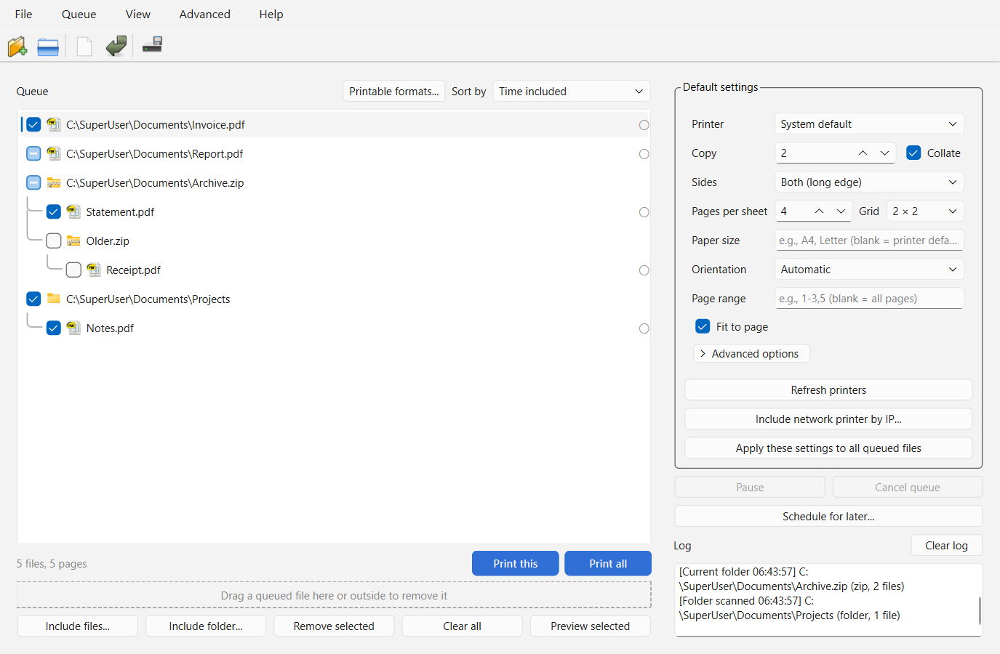
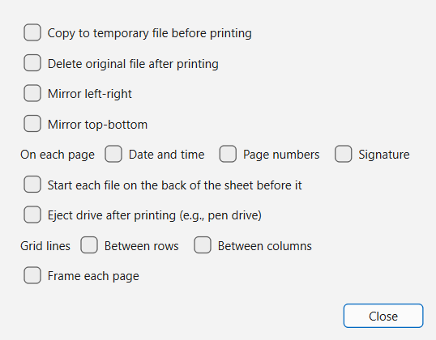
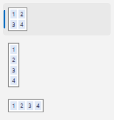
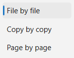
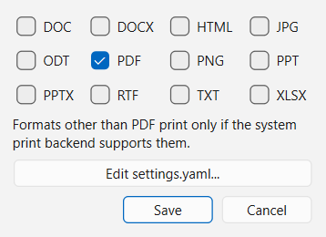

# printtool

Prints files straight to paper, one file or a whole batch, without opening it in a viewer or a print dialog first; PDF and any other format the system can print.



## Features

- Settings: Printer, copies, sides, pages per sheet (preset grids), paper size, page range, fit to page; one set for the whole queue, and any file can have its own.
- Queue: Files, folders, zips (nested too), shortcuts (the file they point to), links and mail attachments, by button or drag and drop.
- Order: File by file, copy by copy, or page by page.
- Print this: The chosen file. Print all: The whole queue, with the file and page printing now.
- Pause, reorder, retry, or print later (the system's scheduler).
- Sheets of paper counted before printing.
- Pages checked before printing: A blank page, a scan with a gray veil, or content in a small part of the page (a receipt in a corner, a scan taken at A0) is offered for skipping, filtering or zooming to fill the paper; presets in Queue behavior.
- Network printers by IP address, beside the printers found by themselves.
- Odd or even pages only, reverse order, booklet (two pages per side in folding order), and two-sided printing by hand for a one-sided printer; settings kept as named presets (Advanced).
- Printing style (Advanced): Color, grayscale, washed out, high or low contrast, color or grayscale negative, sepia; white paper stays white wherever it can.

## Screenshots

| Advanced options | Layouts (4 per sheet) | Order |
|---|---|---|
|  |  |  |

## Mechanism

| OS | Engine |
|----|--------|
| Windows | [SumatraPDF](https://www.sumatrapdfreader.org/) portable, fetched by `scripts/fetch_sumatra.py` and not bundled |
| Linux, macOS | CUPS (`lp`) |

## Install

```bash
pip install -e ".[gui]"
python scripts/fetch_sumatra.py   # Windows only, once
```

Defaults live in a hand-editable `settings.yaml` (`printtool settings-path` prints its location). The "Printable formats..." button above the queue chooses which formats count as printable; only PDF is on by default.



## Usage

```bash
printtool print report.pdf invoice.pdf --printer "Office Printer" --copies 2 --duplex long_edge
printtool batch-folder ./to-print --recursive --paper A4
printtool list-printers
printtool-gui
```

## Acknowledgement

The printer icon is [mono printer](https://openclipart.org/detail/198310/mono-printer) from openclipart.org (CC0). [SumatraPDF](https://www.sumatrapdfreader.org/) (GPLv3) prints on Windows; it is downloaded separately and not part of this repository. Created with Anthropic's Claude.
